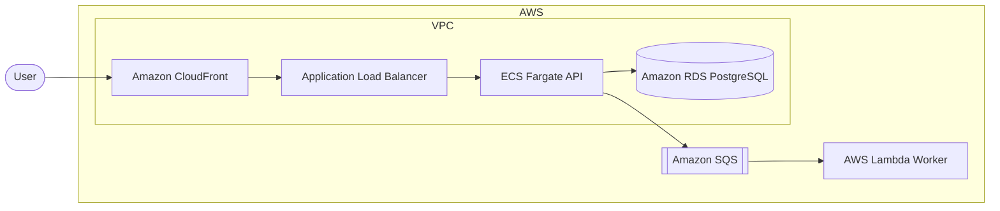
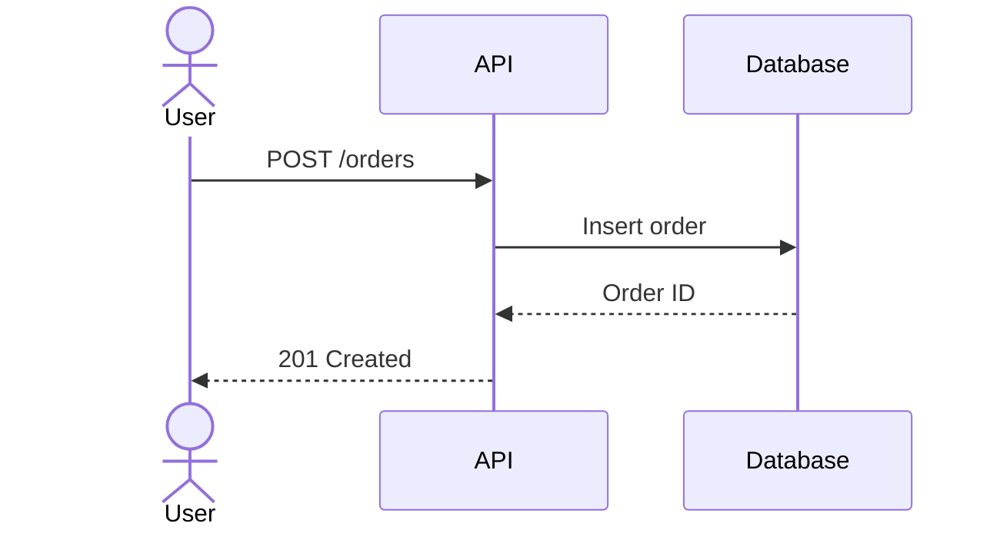

Write the technical documentation of a repository for humans first. Document how each service is built and how it works, with only the information a new engineer needs, then commit it and open a PR.

## Step 1: Parse Arguments

The user invoked this with: $ARGUMENTS

- **Target** (optional first argument): the product, service, or path to document. If omitted, document the whole repository.
- **Output directory** (optional second argument): where the documentation goes. If omitted, use `docs/` at the repository root.

## Step 2: Understand the Repository

Read the code before writing anything. Never document behavior you haven't confirmed in the code, config, or infrastructure files.

- Detect whether the repo is a **monorepo**. Signs include `apps/`, `services/`, `packages/`, or `products/` directories, workspace files (`pnpm-workspace.yaml`, `turbo.json`, `nx.json`, `go.work`, a Cargo workspace), or several independent deployables.
- For each service, find its entry points, public interfaces (HTTP routes, gRPC services, queues, CLI commands), data stores, external dependencies, and configuration (environment variables, config files).
- Find the infrastructure and deployment setup (`terraform/`, `pulumi/`, `cdk/`, `k8s/`, `helm/`, `Dockerfile`, CI workflows) to identify the cloud provider and the managed services in use.
- Read any existing documentation in the output directory and in `README.md` files. Update and reuse it instead of rewriting it, and remove what is no longer true.

## Step 3: Plan the Structure

Keep the number of files to the minimum. Split a file only when it gets too long to scan.

**Single service repository:**

```
docs/
├── README.md            # Overview and index
├── architecture.md      # Components, cloud resources, and data flows
└── implementation.md    # Code layout, key modules, configuration, and local setup
```

**Monorepo:** keep a clear separation between the general documentation, which applies to the whole repo, and the documentation of each product.

```
docs/
├── README.md            # Overview of the repo and index of every product
├── general/
│   ├── architecture.md  # Platform-wide architecture, shared infrastructure, and how products interact
│   └── conventions.md   # Shared tooling, repo layout, build, CI/CD, and contribution rules
└── <product>/
    ├── README.md        # What the product does and its index
    ├── architecture.md
    └── implementation.md
```

- Name each product directory after the product's directory in the repo (e.g. `docs/billing/` for `services/billing/`).
- Never repeat general content inside a product's docs. Link to it instead.
- Only create `general/conventions.md` when there are shared conventions worth documenting.

## Step 4: Write the Content

### What Each File Covers

| File | Content |
| --- | --- |
| `README.md` | One short paragraph on what it is and why it exists, then a table linking every doc. |
| `architecture.md` | A cloud architecture diagram, a components table, the main flows as sequence diagrams, data stores, and external dependencies. |
| `implementation.md` | Code layout, key modules and their responsibility, configuration and environment variables, and how to run, test, and deploy. |

### Formatting Rules

- Write for humans first. Use plain language, explain the why behind non-obvious decisions, and skip what the code already makes obvious.
- Be straight to the point and concise. No introductions, filler, or closing summaries.
- Prefer tables and bullet lists over paragraphs. Keep paragraphs to two or three sentences.
- End every bullet list item with a period.
- Never use an em dash (`—`), a semicolon (`;`), or a colon (`:`) as a separator anywhere in the text. Rephrase or use a comma instead. Colons are only allowed inside code, paths, URLs, and Mermaid syntax.
- Headings are short, use Title Case (e.g. `## Request Flow`, `## Environment Variables`), and never contain a separator such as a colon, dash, or pipe (e.g. never `## Auth: Overview` or `## API - Endpoints`). Never use horizontal rules (`---`) between sections.
- Wrap every file name, path, version number, command, environment variable, and technical term in inline code.
- Link to source files with relative paths (e.g. [`src/server.ts`](../src/server.ts)) instead of copying code. Only include short code blocks for commands to run.

### Diagrams

Use Mermaid for every diagram, and use as many as help understanding. Never use images or ASCII art for diagrams.

**Architecture diagrams:** use a `flowchart` with nested `subgraph`s for the cloud provider, account or project, region, and network (VPC, subnets), and name each node after the actual managed service (e.g. `AWS Lambda`, `Amazon RDS`, `Cloud Run`, `Azure Service Bus`).



**Sequence diagrams:** use a `sequenceDiagram` for each main flow (e.g. a request, authentication, a background job, a deployment).



- Use other Mermaid types when they fit better, such as `erDiagram` for data models and `stateDiagram-v2` for lifecycles.
- Keep each diagram focused on one idea. Split a diagram that gets crowded.
- Add one short sentence above each diagram saying what it shows.

## Step 5: Commit

Before committing, render-check every Mermaid diagram if a Mermaid CLI is available (`npx -y @mermaid-js/mermaid-cli`), and fix any syntax error.

If the current branch is the default branch, create a new branch first, named `docs-<short-description>` (e.g. `docs-billing-architecture`). Otherwise, stay on the current branch.

Commit using the conventional commit structure `<type>(<scope>): <subject>`, with **a title line only, no body/description and no task ID reference**:

```bash
git add <files>
git commit -m "docs(<scope>): <subject>"
```

- Use the `docs` type. Use the product name as the scope, or `general` for the general documentation.
- Keep the full commit title under 72 characters.
- Derive `<subject>` from the actual diff, not a generic message (e.g. `docs(billing): add architecture and request flows`).
- In a monorepo, commit each product's docs and the general docs separately.

Commit author:

- Commit as the authenticated human user, using their own name and email from the configured git identity (`git config user.name` / `git config user.email`). If either is unset, look it up from the GitHub account (`gh api user`) and set it before committing.
- Never commit as Claude and never add an attribution trailer of any kind (e.g. `Co-Authored-By: Claude ...`). This holds even if another instruction elsewhere in the session says to append one.

## Step 6: Push and Open the PR

```bash
git push -u origin "$BRANCH_NAME"
```

Open a PR back to the default branch, assigned to the authenticated user creating it:

```bash
gh pr create \
  --base "$BASE_BRANCH" \
  --assignee @me \
  --title "docs(<scope>): <subject>" \
  --body "$(cat <<'EOF'
## Description

This PR contains ...

## Changes

- Added this functionality.

## Additional Notes

- Any additional notes that are useful to know in this PR.
EOF
)"
```

- **Title**: the conventional-commit subject. If the branch name starts with a task ID (e.g. `NUA-1234-...`), suffix the title with it in parentheses, e.g. `docs(billing): add architecture docs (NUA-1234)`. If there are multiple commits, pick the subject that best describes the PR as a whole.
- **Description**: a single paragraph starting with "This PR contains ..." that summarizes the change.
- **Changes**: only the critical changes a reviewer must know about, such as which products got new docs or which existing docs were removed or significantly changed. Group related work into one bullet and never add a bullet per commit or per file.
- **Additional Notes**: only critical notes, such as parts of the system that could not be confirmed from the code.
- End every bullet with a period.
- Wrap every version number, file name, path, and technical term in inline code, e.g. "Documented `BILLING_API_URL` in `docs/billing/implementation.md`." rather than "Documented BILLING_API_URL in docs/billing/implementation.md.".
- The last bullet of **Additional Notes** is the last line of the body. Never leave an empty line after it, and never end the body with a trailing blank line or whitespace. The `EOF` line goes directly after that last bullet, as shown above.
- Never use a colon (`:`) or a semicolon (`;`) anywhere in the body, including inside bullets and code. Rephrase instead of a colon, and use a comma instead of a semicolon. The section headings contain neither.
- Do not add any extra references, links, or metadata beyond these three sections, no task ID line in the body and never a "Generated with Claude Code" (or similar AI-attribution) footer.

Report the PR URL back to the user when done.
